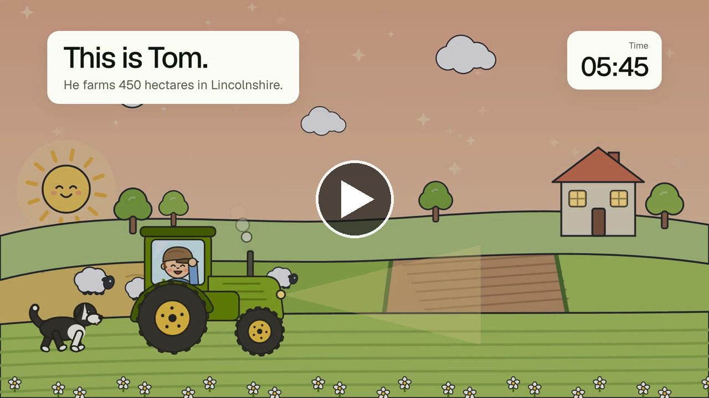
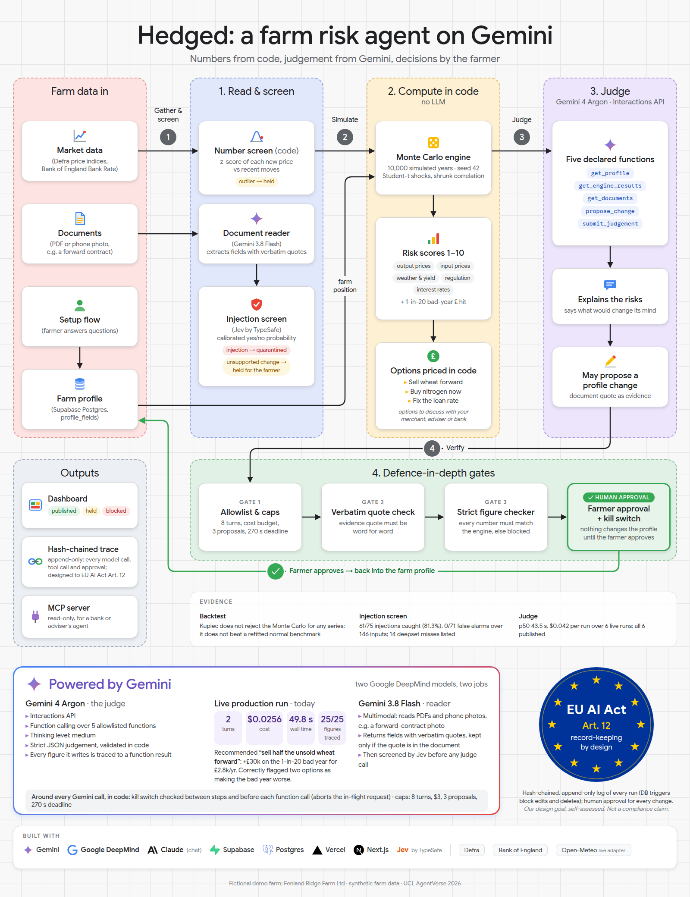
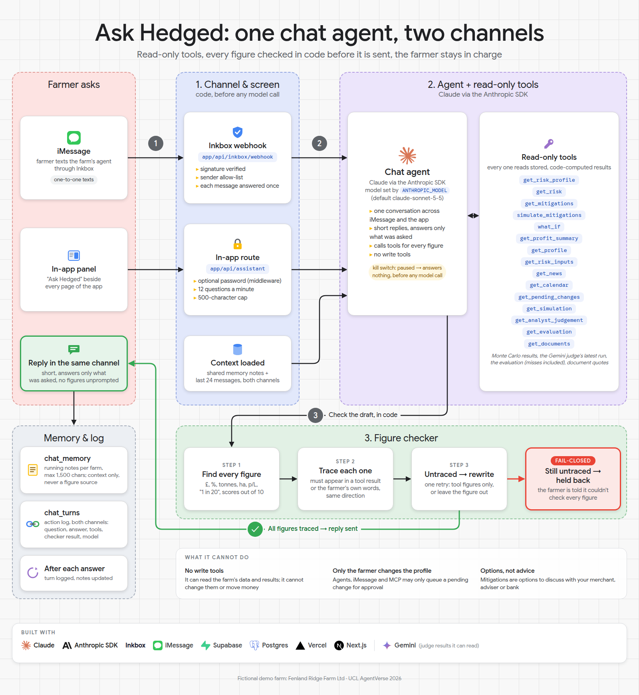

# Hedged

A risk agent for UK arable farmers: it shows in £ what each risk could cost the farm and which options would reduce it. Numbers come from code, judgement from Gemini, decisions from the farmer.

Live demo: https://agentverse-green.vercel.app (demo farm: Fenland Ridge Farm Ltd, fictional, 450 ha near Sleaford, Lincolnshire).

<!-- Akeel: GitHub only plays inline video uploaded through the web editor. To get an inline player,
     edit this README on github.com and drag docs/media/hedged-explainer.mp4 into the editor here;
     GitHub replaces it with a user-attachments link. The image below links to the file meanwhile. -->
[](docs/media/hedged-explainer.mp4)

## Problem

An arable farmer's profit swings with crop prices, fertiliser and fuel, weather, policy and interest rates. Each year they decide what to sell forward, what to buy now and what to fix, usually without seeing what a bad year would cost the whole farm. The bank lending to them sees even less.

## Who it's for

- **The farmer** running a farm like Fenland Ridge: 450 ha of wheat, barley and oilseed rape, a variable-rate loan.
- **The bank or adviser** who lends to them, reading the same figures over a read-only MCP endpoint (`covenant_view` gives the debt-service cover view).

## Impact

Each risk is shown as the £ hit in a 1-in-20 bad year, with options priced in code. In a live run on the demo farm the agent recommended **"sell half the unsold wheat forward": +£30k on the 1-in-20 bad year for £2.8k a year**, and flagged two other options as making the bad year worse (shown in the infographic below; the hedge is picked in code from the engine's `p5_gain`, `lib/trace/decision.ts`). The farmer then taps "discuss" or "not now", and that choice is recorded on the run's trace.

Options are to discuss with your merchant, adviser or bank, not advice.

## Beyond farming

The same pattern fits any business with commodity, input-cost, weather or rate exposure: food processors, hauliers, energy-intensive SMEs, construction firms. Swap the profile and the data feeds; the engine, the judge, the trace and the human approval step stay as they are.

## How it works



| Role | Model | May do | May not do |
|---|---|---|---|
| Compute every number | TypeScript engine (`lib/engine`) | Monte Carlo (10,000 paths, seed 42), P&L, DSCR, backtest | judge |
| Read documents and photos | `gemini-3.8-flash` | extract fields, each with a verbatim quote | change anything |
| Screen free text | Jev `jev-latest` (TypeSafe) | score whether text tries to instruct the AI | arithmetic, prose |
| Judge and explain | `gemini-4-argon` (Interactions API) | rank options, explain, say what would change its mind, propose changes | produce a number, write to the profile |
| Chat (iMessage and in-app) | Claude (`ANTHROPIC_MODEL`) | answer questions with read-only tools | change anything |

## Traceable reasoning (25%)

- Every figure is computed in `lib/engine/`, with seed and config hash on each run. The judge reads results only through five declared functions and cannot produce a number. [/trace](https://agentverse-green.vercel.app/trace) labels each step Computed (code), Decided (Jev), Read (Flash) or Judged (Argon).
- Each cited £ figure on a run links to its function result, observation and source; a risk page's "View trace" link lands on the figure's formula and inputs ([screenshot](docs/eval/screenshots/trace-figure-anchor.png)).
- `checkFiguresStrict` (`lib/agents/checker.ts`) blocks any number in the judgement that does not match an engine figure in unit and sign; a blocked run's explanation is withheld.
- The judgement must list what would change its mind, each entry tied to an engine threshold id (`lib/agents/risk/schema.ts`). Each risk page also shows, worked out in code, the exposure at which its score moves (`lib/what-would-change.ts`).
- Every step is appended to a hash chain, `sha256(prev_hash || canonical(event))`, which the trace page recomputes and shows as intact or broken (`lib/trace/chain.ts`).

## Testing on unseen data (25%)

All farm data is synthetic; the market history is real. Nothing here is real-world trading or lending performance. Full write-up: [docs/eval/README.md](docs/eval/README.md).

- **Simulation backtest** ([backtest.md](docs/eval/backtest.md)): one-month-ahead 5th/95th percentiles, walk-forward 2017–2026 on Defra and Bank of England history, 115 forecasts per series, origins from 2024 held out (n = 31). Kupiec does not reject the Monte Carlo for any series, but **it does not beat a normal distribution refitted each month** (pinball loss about equal); it beats historical simulation on every series.
- **Losses:** nitrogen breaches cluster in 2021–23 (Christoffersen p ≈ 0.00), so the model misses regime shifts. The Student-t tails and nitrogen factor were chosen knowing 2022 happened.
- **Input screen** ([screen-eval.md](docs/eval/screen-eval.md)): 61 / 75 injections caught (81.3%, 95% CI 71.1%–88.5%), 0 / 71 false alarms, on 146 inputs including the public deepset/prompt-injections test split. All 14 misses are listed.
- **Bad input caught on screen:** a contract photo with a printed instruction is read by Flash, caught by Jev, and the run is held before any judge call ([screenshot](docs/eval/screenshots/trace-held-injection-photo.png)).
- **Judge runs** ([run-timings.md](docs/eval/run-timings.md)): p50 43.5 s and $0.042 per run over 6 live runs, all published. One took 69.0 s. Six runs is a small sample.

## Risk controls and oversight (15%)

Limits are enforced in code, not the prompt. Scripted-client tests: `tests/risk-agent.test.ts`, `tests/judge-route.test.ts`, `tests/trace.test.ts`, `tests/screen.test.ts`, `tests/chat-agent.test.ts`.

| Control | Enforced in | Fired on screen? |
|---|---|---|
| Kill switch: checked before each function call, aborts the in-flight Gemini request; fails closed | `lib/agents/risk/run.ts`, `lib/server/agent-store.ts` | Yes, live run ended `killed` ([screenshot](docs/eval/screenshots/kill-switch-fired.png)) |
| Input screen: Jev on every document, z-score check on new prices | `lib/screen/screen.ts`, `lib/assess/phase-one.ts` | Yes, injection photo held |
| Farmer approves every profile change; agents write only to `pending_changes` | `lib/agents/risk/tools.ts`, `supabase/migrations/0005_agent_runs.sql` | Yes, [/profile#approvals](https://agentverse-green.vercel.app/profile#approvals) |
| Loss limit checked against the whole-farm 1-in-20 bad year | `lib/limits.ts` | Yes, overview banner turns red past the limit |
| Strict figure checker: untraced number blocks the run | `lib/agents/checker.ts` | Scripted tests only |
| Function allowlist, turn cap, budget cap, 270 s deadline, proposal cap | `lib/agents/risk/tools.ts`, `lib/agents/risk/run.ts` | Scripted tests only |
| Append-only trace: DB triggers reject update, delete, truncate | `supabase/migrations/0005_agent_runs.sql` | Chain check on every trace page |
| Chat agent read-only; untraced figure gets one rewrite, then the reply is held | `lib/agents/chat/agent.ts`, `lib/agents/checker.ts` | Logged at [/activity](https://agentverse-green.vercel.app/activity) |

- Every chat turn, approval and snapshot is logged at [/activity](https://agentverse-green.vercel.app/activity); every agent step at [/trace](https://agentverse-green.vercel.app/trace).
- EU AI Act: Art. 12 record-keeping by design (self-assessed, not a compliance claim).

## Relevance and impact (20%)

- A named user: a UK arable farmer deciding what to sell forward, buy now or fix, and the bank that lends to them.
- Each risk becomes a £ hit in a 1-in-20 bad year and a 1–10 score against typical profit (`lib/score.ts`), with priced options ([/overview](https://agentverse-green.vercel.app/overview)).
- **Worst failure handled on screen:** a forward contract the profile doesn't know about. The farmer photographs it at [/documents](https://agentverse-green.vercel.app/documents); Flash reads "200 tonnes"; the judge flags the conflict and proposes 0 → 200 t; the farmer approves it ([screenshot](docs/eval/screenshots/approvals-agent-proposal.png)).
- **Second failure:** a manipulated document is held before the judge runs, and the profile does not change.
- Limit: no farmer survey or interviews are cited; the need is stated, not measured here.

## Ambition and technical quality (15%)

- A phone photo becomes a checked, approvable profile change: Flash reads, Jev screens, code computes, Argon judges, code checks, the farmer taps. The LLMs do only what a conventional program can't: read the photo and explain the trade-off.
- Engine written for this: seeded Student-t draws, Ledoit-Wolf shrunk correlation, Kupiec, Christoffersen and pinball statistics, and a walk-forward backtest that calls the same simulation (`lib/engine/`).
- Our own agent loop over the Gemini Interactions API, not a framework (`lib/agents/risk/run.ts`).
- Read-only MCP server for an adviser's or bank's agent (`app/api/mcp`, `get_risk_profile`, `covenant_view`).
- One chat agent across iMessage and the in-app panel, every figure checked in code before it is sent:



## Limits

- The Monte Carlo does not beat a normal refit; high-side breaches run above 5% for barley, rape and fuel. Regulation is not backtested, and the backtest checks each factor's tails, not their joint structure.
- The whole-farm check is n = 7 harvests and descriptive only.
- Farm attack texts were written by an AI subagent; the photo set is n = 10. Jev catches injected instructions, not a forged figure with no instruction (the quote check and farmer approval cover those).
- In live agent runs only the kill switch and the screen hold have fired; the other agent controls fire only in scripted tests.
- p50 judge time (43.5 s) is close to Vercel Hobby's 60 s cap; the judge route needs Vercel Pro or `bun run agent:demo` locally.
- Without `HEDGED_PASSWORD` the server actions are public; the password is one shared secret, not per-user auth. One demo farm.

## Run it

```bash
bun install
bun run dev          # http://localhost:3000 -> /overview, in-memory demo data without keys
bun run test         # vitest
bun run backtest     # rewrites docs/eval/backtest.{json,md}
```

Env vars are in `.env.example` (server-side only, none committed). Supabase: run `supabase/migrations/*` in order, then `supabase/seed.sql`. Architecture detail: [docs/architecture.md](docs/architecture.md).

## Data and licences

All farm data, documents and photos are **synthetic**, made by the team (`lib/profile/fenland-ridge.ts`, `lib/mock.ts`, `scripts/make-demo-docs.py`); the farm is fictional. No real financial records, accounts or logins.

| Data | Source | Licence | Real or synthetic |
|---|---|---|---|
| Wheat, barley, rape, nitrogen and fuel price indices, monthly from 2014 | Defra Agricultural Price Index | OGL v3.0 | Real (`data/history.json`, URL and sha256) |
| East Midlands cereal and oilseed yields | Defra | OGL v3.0 | Real |
| Bank Rate | Bank of England IADB | free reuse with attribution | Real |
| Prompt-injection test split (116 rows) | deepset/prompt-injections | Apache-2.0 | Public dataset |
| Farm profile, demo documents, attack texts and photos | made for this project | n/a | Synthetic |
