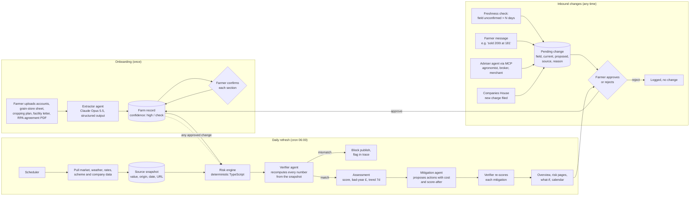
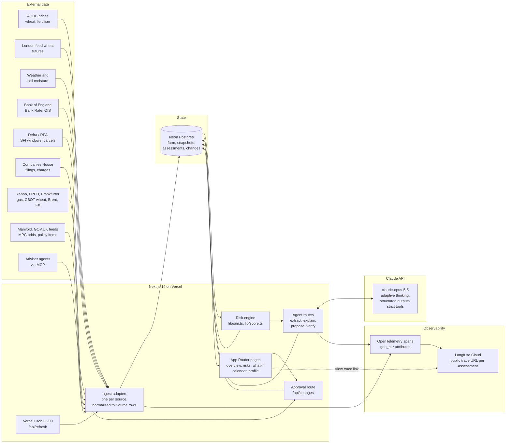
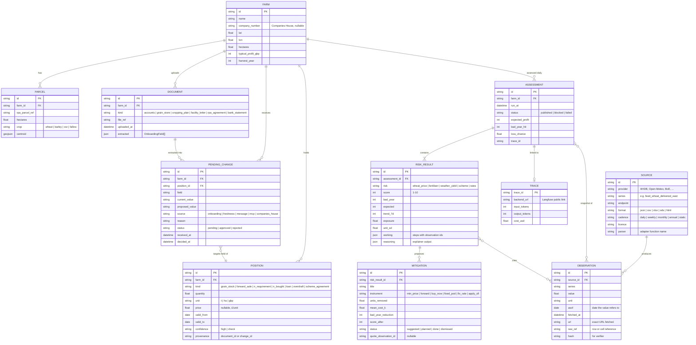
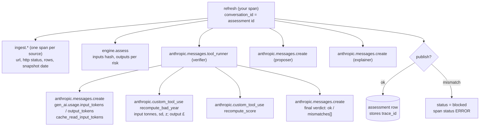

# Headwind: agent architecture and end-to-end flow

Status: draft for the AgentVerse build, 7-8 Nov 2026. Fictional farm, real data sources.

Headwind turns a UK arable farm's position (tonnes unsold, nitrogen unbought, debt unfixed, scheme agreements expiring) plus live market, weather and policy data into one number per risk: the £ hit in a 1-in-20 bad year, as a share of a typical year's profit. It then proposes mitigations, and nothing about the farm's record changes without the farmer approving it.

## 1. End-to-end process



Rules the flow enforces:

- Every figure on screen traces to a row in the source snapshot with origin and date. The verifier refuses to publish an assessment whose numbers it cannot reproduce.
- Only the farmer writes to the farm record. Agents and external feeds can only create pending changes.
- The risk maths is plain TypeScript (`lib/sim.ts`, `lib/score.ts`), not model output. Models extract, explain, propose and verify. They never compute the score.

## 2. System architecture



## 3. Data sources

Verified 7 Nov 2026 by fetching each endpoint. "No API" means the realistic path is a spreadsheet download or an HTML scrape on the cron, cached as a JSON snapshot in the repo so the demo survives a blob move.

### 3.1 Market prices

| Need | Source | Endpoint | Format | Auth | Frequency | Licence |
|---|---|---|---|---|---|---|
| Delivered feed wheat, spot and forward by region | AHDB UK delivered prices | `projectblue.blob.core.windows.net/media/Default/MI Reports/D&A Arable/Daily and Weekly Price Reports/UK Delivered Cereals Oilseed Prices.xlsx` | XLSX, latest week only | none | Weekly, Friday | AHDB terms, internal business use |
| Ex-farm wheat history 2014 to now, monthly by region | AHDB Corn Returns | same blob folder, `Corn Returns prices month_year.xlsx` | XLSX, 2,158 rows | none | Weekly, Monday | AHDB terms |
| ICE UK feed wheat futures strip | AHDB markets page | `https://ahdb.org.uk/cereals-oilseeds-markets` table "UK (ICE) Feed Wheat £/t" | HTML, server-rendered | none | Daily, weekdays | AHDB terms |
| Ammonium nitrate £/t, weekly since Mar 2026 plus 438 monthly rows of history | AHDB GB fertiliser price series | `projectblue.blob.core.windows.net/media/Default/Market Intelligence/GBFertiliserPriceSeries.xlsx` | XLSX | none | Weekly, Friday | AHDB terms |
| Licence-clean index for nitrogen and cereals, 2014 to now | Defra Agricultural Price Index | resolve via `https://www.gov.uk/api/content/government/statistics/agricultural-price-indices` then `details.attachments[].url` | CSV, 2020 = 100 | none | Monthly | OGL v3 |

AHDB has no API. Hectare Trading market insights sit behind a login with no public API. ICE's own delayed-quote JSON and Barchart pages were not verified and are likely bot-blocked.

### 3.2 Weather, soil and yield

| Need | Source | Endpoint | Format | Auth | Limits | Licence |
|---|---|---|---|---|---|---|
| Forecast, rain, ET0, soil moisture at four depths | Open-Meteo forecast | `https://api.open-meteo.com/v1/forecast?latitude=&longitude=&hourly=soil_moisture_0_to_1cm,soil_moisture_27_to_81cm,precipitation,et0_fao_evapotranspiration` | JSON | none | 10k calls/day free, non-commercial | CC BY 4.0 |
| Seasonal outlook to 9 months, ensemble members | Open-Meteo seasonal | `https://seasonal-api.open-meteo.com/v1/seasonal?...&forecast_days=45` | JSON | none | as above | CC BY 4.0 |
| 10-year rain and ET0 for yield-stress proxy | Open-Meteo archive (ERA5) | `https://archive-api.open-meteo.com/v1/archive?...&start_date=2016-01-01` | JSON | none | 5-day lag | CC BY 4.0 |
| Met Office branding on the forecast | Met Office Weather DataHub | `https://data.hub.api.metoffice.gov.uk/sitespecific/v0`, header `apikey` (header name unverified) | JSON | free key | 360 calls/day | Met Office terms |
| Regional wheat yield 1999 to 2026, 5-year average | Defra cereal and OSR production | `https://assets.publishing.service.gov.uk/media/6ac66b15f1ba855cc196a8c8/UK-cops-webseries_261008.ods` sheet `Regional_wheat` | ODS | none | Annual | OGL v3 |

Open-Meteo is the only true live JSON API in the stack. Copernicus CDS is queued and slow, so skip it.

### 3.3 Land, schemes, finance, company

| Need | Source | Endpoint | Format | Auth | Limits | Licence |
|---|---|---|---|---|---|---|
| Parcel locations near the farm | RPA Parcel Points (England) | `https://environment.data.gov.uk/spatialdata/rpa-parcel-points-england/ogc/features/v1/collections/.../items?bbox=` | GeoJSON, centroids only | none | annual | OGL v3 |
| Live SFI actions by parcel | SFI Scheme Actions (England) | dataset `environment.data.gov.uk/dataset/58cc85ab-...` OGC Features | GeoJSON | none | periodic | OGL v3 |
| Scheme action payment rates | gov.uk content API | `https://www.gov.uk/api/search.json?filter_content_store_document_type=farming_grant&count=203` then `/api/content/find-funding-for-land-or-farms/<slug>` | JSON, rates inside body HTML | none | none | OGL v3 |
| SFI26 windows and caps | Defra blog and news | hard-code: window 1 June 2026, window 2 opened 22 Sep 2026 and closed within a day, £100k/yr cap, early renewal for agreements expiring by 28 Feb 2027 | HTML | none | static | OGL |
| Bank Rate and SONIA, daily | Bank of England IADB | `https://www.bankofengland.co.uk/boeapps/database/_iadb-fromshowcolumns.asp?csv.x=yes&Datefrom=01/Jan/2016&Dateto=now&SeriesCodes=IUDBEDR,IUDSOIA&CSVF=TN&UsingCodes=Y&VPD=Y&VFD=N` | CSV | none | daily | BoE terms |
| OIS curve | Bank of England yield curves | `oisddata.zip`, 12 MB | ZIP of XLSX | none | daily | BoE terms |
| Charges, filings, accounts | Companies House Public Data API | `https://api.company-information.service.gov.uk/company/{number}/filing-history` | JSON | free key as Basic auth username | 600 requests per 5 min | CH terms |

RPA does not publish parcel polygons openly, so draw mock boundaries around the points. Rural Payments has no third-party API. Most arable farms are partnerships with no Companies House record, so the demo farm stays a Ltd. Farm software (Yagro, Gatekeeper, Omnia) exposes no public API, so adviser data arrives as CSV upload or via a mocked MCP server.

### 3.5 Team-suggested sources, checked 7 Nov 2026

Each endpoint below was called from this machine. The suggestion list assumed Python; the stack is TypeScript, so the Yahoo and spreadsheet paths use plain `fetch` and the `xlsx` package rather than yfinance and pandas.

| Suggested | Result | Use in Headwind |
|---|---|---|
| Yahoo Finance chart API, `query1.finance.yahoo.com/v8/finance/chart/{ticker}` | Works without a key for `TTF=F` (Dutch gas, EUR), `ZW=F` (CBOT wheat, US cents/bu), `KE=F` (KC wheat). `MWT=F`, `ECO.PA`, `EBMZ26.PA`, `ECOZ26.PA` return "symbol may be delisted". `EBM=F` responds but the value is not a €/t wheat price, so do not use it. Rapeseed only exists as an index (`ENRSE.PA`) | Gas as the fertiliser shock signal, CBOT wheat as the global price signal. Euronext milling wheat is not reliably on Yahoo, so the UK strip stays on the AHDB table and Paris parity is a fallback only |
| FRED API, `api.stlouisfed.org/fred/series/observations?series_id=…&api_key=…&file_type=json` | Free key. `IUDSOIA` (SONIA), `DCOILBRENTEU` (Brent), `PCU325311325311` (US nitrogen fertiliser PPI) exist. `IUDBEDR` (Bank Rate) is not on FRED, 404 | JSON mirror for SONIA and Brent. Bank Rate stays on the BoE IADB CSV |
| Frankfurter FX | Moved to `https://api.frankfurter.dev/v1/latest?from=GBP&to=EUR,USD`. Old `.app` host 301s. Returns ECB reference rates, no key. GBP/EUR 1.1988 on 6 Nov | Daily FX for Paris parity and the what-if slider |
| Manifold Markets, `api.manifold.markets/v0/search-markets?term=bank%20of%20england%20rate` | Works, no key. Returns MPC decision markets (18 Dec 2026, 1 Jan 2027). They are multiple-choice, so read `answers[].probability`, not the top-level `probability`, which is 0 | Crowd odds on the next MPC move for the interest-rate page. Label as play-money forecasts |
| GOV.UK Search API, `www.gov.uk/api/search.json?filter_organisations=…&order=-public_timestamp` | Works. Defra, RPA, HM Treasury, DESNZ and Environment Agency all valid organisation slugs | Daily poll for policy items on the Schemes lane. Explainer summarises titles only, never the body |
| GOV.UK Atom feeds, `www.gov.uk/government/organisations/rural-payments-agency.atom` | Works, 200 | Same purpose, cheaper than search |
| Farmers Weekly RSS | `/feed` and `/rss` redirect, `/arable/feed` 404. Not verified | Skip. GOV.UK feeds cover the scheme news; AHDB covers prices |
| GDELT doc API | Responds but throttles to one request per 5 seconds | One query per refresh at most, UK-sourced wheat and fertiliser headlines. Optional |
| NewsAPI.org, OilPriceAPI | Not checked | Skip, FRED and Yahoo cover energy |
| Companies House, BoE IADB, AHDB spreadsheets, Open-Meteo, Defra ODS | Already in 3.1 to 3.3 | As above |

Net change to the minimal set: add Frankfurter for FX, Yahoo for gas and CBOT wheat, Manifold for MPC odds, and the GOV.UK search feed. Drop the Met Office DataHub.

### 3.6 Minimal set for the 33-hour build

1. Open-Meteo forecast, archive and seasonal. Live, JSON, no key.
2. Bank of England IADB CSV for Bank Rate and SONIA. One fetch. Frankfurter for GBP/EUR and GBP/USD.
3. The three AHDB spreadsheets, parsed with the `xlsx` package on the cron and committed as JSON snapshots.
4. AHDB markets HTML table for the ICE forward strip, or the hard-coded strip from 7 Nov: Nov-26 189.00, Jan-27 192.25, Mar-27 195.50, May-27 198.75, Jul-27 202.00.
5. Defra price-index CSV as the OGL-licensed volatility series shown in the pitch.
6. gov.uk content API plus hard-coded SFI26 dates for the Schemes lane.
7. RPA parcel points for the profile map.
8. Companies House only because the demo farm is a Ltd.
9. Defra regional wheat yield ODS, parsed once and committed.
10. Yahoo chart API for TTF gas and CBOT wheat, Manifold for the next MPC decision, GOV.UK search for Defra and RPA items. All JSON, no key.

## 4. Data model

Everything the agent reads or writes is one of eight entities. The two that matter most are `Observation` (one row per value fetched from a source, with provenance) and `PendingChange` (the only way the farm record changes).



### 4.1 The observation row

Every adapter, whether it parses JSON, a spreadsheet or an HTML table, returns the same row. This is what the verifier recomputes from and what the sources panel renders.

| Field | Example | Rule |
|---|---|---|
| `source_id` | `ahdb_delivered` | Matches a row in the source registry |
| `series` | `feed_wheat_delivered_east_spot` | One series per cell the engine reads |
| `value`, `unit` | `178`, `gbp_per_t` | Numeric only. Text goes in `raw_ref` |
| `asof` | `2026-11-06` | The date the provider says the value is for, not when we fetched it |
| `fetched_at` | `2026-11-07T06:02:11Z` | Set by the adapter |
| `url` | the exact blob or API URL | Clickable from the UI |
| `raw_ref` | `Wheat!C14` or `hourly.soil_moisture_27_to_81cm[0]` | Lets a judge find the cell |
| `hash` | sha256 of `source_id:series:asof:value` | Verifier compares against the assessment's cited ids |

Freshness is derived, not stored: `now - asof` against the source's `cadence`. A weekly series older than 10 days flags the risk page as stale.

### 4.2 Which inputs feed which risk

| Risk | Farm positions | Observation series | Volatility series | Shock signals |
|---|---|---|---|---|
| Wheat price | `grain_stock`, `forward_sale`, 2027 expected tonnes from `PARCEL` | AHDB delivered east spot and forward, ICE strip, Euronext milling wheat via Yahoo, GBP/EUR | AHDB Corn Returns monthly 2014 on | Manifold BoE odds (indirect), GOV.UK Defra feed, GDELT headlines |
| Fertiliser | `n_requirement`, `n_bought` | AHDB AN weekly, TTF gas futures via Yahoo, Brent via FRED, FRED nitrogen PPI | AHDB fertiliser monthly history | TTF move week on week |
| Weather and yield | `PARCEL` areas and crops | Open-Meteo soil moisture, rain, ET0; seasonal ensemble | Open-Meteo ERA5 archive 2016 on; Defra regional yields 1999 on | Soil moisture percentile versus archive |
| Scheme payments | `scheme_agreement` | GOV.UK content API payment rates, SFI actions GeoJSON | none | GOV.UK search feed for Defra and RPA, SFI26 window dates |
| Interest rates | `loan`, `overdraft` | BoE Bank Rate and SONIA (IADB CSV), SONIA via FRED, OIS curve | BoE IADB 2016 on | Manifold MPC decision markets, GOV.UK HM Treasury feed |

### 4.3 Source registry

The registry is a committed JSON file, one entry per `SOURCE`, so adding a feed is a data change plus one adapter function. Adapter signature:

```ts
type Adapter = (src: Source, ctx: { farm: Farm; now: Date }) => Promise<Observation[]>;
```

Adapters never throw into the engine. A failed fetch returns zero rows, the cron records a `fetch_failed` span, and the engine uses the latest prior observation with `stale: true` surfaced on the page.

## 5. Agent design

Four model roles, one engine. All calls use `claude-opus-5-5` with adaptive thinking (the default), through `@anthropic-ai/sdk`.

| Role | Trigger | Input | Output | How |
|---|---|---|---|---|
| Extractor | Onboarding upload | PDF or XLSX as a `document` block | `OnboardingField[]` with value, source, confidence | `client.messages.parse()` with a Zod schema; `confidence: "check"` for anything inferred rather than read |
| Explainer | After each assessment | Assessment plus the source snapshot rows | `reasoning[]` and `summary` for a risk page | Structured output. The prompt forbids any number not present in the snapshot; the verifier checks this |
| Proposer | After each assessment | Risk, farm record, available instruments and quotes | `Mitigation[]` with cost, units removed, status "suggested" | Strict tools: `quote_min_price`, `quote_forward`, `quote_fixed_rate`, each a thin adapter over a source or a mock |
| Verifier | Before publish | Assessment, mitigations, snapshot, the engine functions as tools | `{ ok, mismatches[] }` | Tool runner with `recompute_bad_year` and `recompute_score` tools bound to `lib/sim.ts` and `lib/score.ts`. Any number the verifier cannot reproduce within rounding blocks publish |

Why the engine stays deterministic: the judges want reasoning a professional can check. A 1-in-20 figure that comes from a z-score times a standard deviation times exposed tonnes is checkable on a napkin. A figure that comes from a model is not. The models only read documents, write prose, propose instruments and audit.

Human in the loop: every inbound signal (freshness timer, farmer message, adviser MCP, Companies House) becomes a `PendingChange`. The farm record only changes through the approval route. Agents never hold a write tool to the farm record.

Prompt caching: system prompt and tool list first and frozen, then the snapshot with a `cache_control` breakpoint, then the per-risk question. Verify with `usage.cache_read_input_tokens` on the second call of each refresh.

## 6. Observability

Goal on stage: open any risk page, click "View trace", and show the judges the exact prompts, tool calls, recomputed numbers, token cost and latency behind the figure on screen.

### 6.1 Trace tree per refresh



### 6.2 Mechanics

The Anthropic TypeScript SDK emits OpenTelemetry spans itself (beta), with `gen_ai.*` attributes, so any OTLP backend reads them without mapping. Two settings matter for the demo:

- `traces.contentMode: "content"` so prompts and responses are in the span. Default is metadata only, which would make the trace useless to a judge.
- `conversationId` set to the assessment id on every call in one refresh, so the backend groups the verifier, proposer and explainer under one conversation.

The tracer provider is registered once in `instrumentation.ts` (final version in 6.4).

```ts
// lib/claude.ts
import Anthropic from "@anthropic-ai/sdk";
export const client = new Anthropic({
  openTelemetry: { traces: { contentMode: "content" } },
});

// per call inside the refresh
await client.messages.create(params, { openTelemetry: { conversationId: assessmentId } });
```

Wrap the whole refresh in one span from `@opentelemetry/api` (`tracer.startActiveSpan("refresh", ...)`) so the SDK spans nest under it, and record `span.spanContext().traceId` on the assessment row. The risk page links to `${TRACE_BASE_URL}/${traceId}`.

Vercel serverless note: flush the span processor before the route returns, or spans are lost when the function freezes.

### 6.3 What the verifier span must contain

For the "checkable by a professional" criterion, each `recompute_*` tool span carries the inputs and output as attributes, not just in the prompt text. A judge can read: tonnes exposed 2,898, price sd £20/t, z 1.645, bad-year £95.3k, engine said £96k, within rounding. That is the whole observability story in one span.

### 6.4 Backend choice

Verified 7 Nov 2026 unless marked. Setup time assumes Next.js on Vercel with an `instrumentation.ts`.

| Platform | Free tier | Setup | Ingests OTel GenAI spans | Tool calls, I/O, cost, latency | Evals | Public trace link |
|---|---|---|---|---|---|---|
| **Langfuse Cloud** (EU/US, MIT self-host) | Hobby: no card, 50k units/month, 2 users | 15 min, one span processor and two env vars | Yes, native OTLP; Anthropic lists it as a built-in API-tracing destination | Yes | LLM-as-judge, annotation queue, scores API | Yes, one call per trace |
| LangSmith | Developer: 1 seat, 5k traces/month then $2.50 per 1k | 15 min | Yes, OTLP endpoint | Yes | Datasets, evaluators | Share links (unverified) |
| Arize Phoenix | OSS free; cloud 25k spans/month, 15-day retention (secondary source) | 20 min | Yes, OpenInference plus GenAI | Yes | Evals library | Unverified |
| Braintrust | Starter: 1 GB data, 14-day retention (secondary source); Pro $249/month | 15 min | Yes | Yes | Strongest, CI gating | Unverified |
| Helicone | 10k requests/month, 7-day retention | 5 min, base-URL proxy | Proxy model, no tool-execution spans | Cost and latency only | Limited | Unverified |
| Sentry AI Insights | Developer plan, limits unverified | 15 min if Sentry already present | Yes | Yes | None | Org-internal only |
| Vercel AI Gateway observability | Included | None if routed via Gateway | Not a trace store | Requests, usage, cost, no tool tree | None | No |

Decision: **Langfuse Cloud EU** as the only trace store. It is the one option verified to give a public link per trace, which is what lets a judge open the exact run on a phone. It takes both span sources (the Anthropic SDK's own spans and the app's spans) through one tracer provider, and the Anthropic API can additionally be pointed at it server-side by an org admin for model-request spans that nest under ours.

Final `instrumentation.ts`, replacing the generic exporter in 6.2:

```ts
import { NodeSDK } from "@opentelemetry/sdk-node";
import { LangfuseSpanProcessor } from "@langfuse/otel";

export async function register() {
  if (process.env.NEXT_RUNTIME !== "nodejs") return;
  const sdk = new NodeSDK({ spanProcessors: [new LangfuseSpanProcessor()] });
  sdk.start(); // global provider; @anthropic-ai/sdk spans land here with no further wiring
}
```

```
LANGFUSE_PUBLIC_KEY=pk-lf-...
LANGFUSE_SECRET_KEY=sk-lf-...
LANGFUSE_BASE_URL=https://cloud.langfuse.com
ANTHROPIC_API_KEY=sk-ant-...
ANTHROPIC_OPEN_TELEMETRY_TRACES_CONTENT_MODE=content
CRON_SECRET=<random>
```

Make the trace public from the refresh span with `startObservation(...).setTraceAsPublic()` from `@langfuse/tracing`, and store its trace id on the assessment row. Run `LangfuseSpanProcessor.forceFlush()` before the cron route returns.

Packages: `@anthropic-ai/sdk @opentelemetry/sdk-node @langfuse/otel @langfuse/tracing zod`. The Vercel AI SDK is not needed; the Anthropic SDK's tool runner and `messages.parse()` cover the loop and structured output.

### 6.5 Runtime notes

- Vercel Cron on Hobby fires once a day with up to 59 minutes of drift, so `0 6 * * *` lands between 06:00 and 06:59. Fallback: a GitHub Actions schedule hitting `/api/refresh` with the `CRON_SECRET` bearer token.
- Storage: Neon Postgres (free 512 MB, Vercel Marketplace, does not pause). Supabase's free project pauses after 7 idle days, which is a demo-day risk. Tables: `farm`, `source_snapshot`, `assessment` (with `trace_id`), `pending_change`.
- Human in the loop needs no durable-execution library. The proposer writes `pending_change` rows; the approval route flips `status`; the next refresh reads approved rows. The agent run ends after proposing.

## 7. Hackathon scope

Build order, each step demoable on its own:

1. Cron route that pulls Open-Meteo and the BoE CSV, writes a snapshot, re-runs the engine. Overview page shows a live `updatedAt`.
2. AHDB spreadsheets parsed to JSON, replacing the hard-coded £178/t and £504/t. Sources panel shows real dates.
3. Verifier agent with trace link on every risk page. This is the observability demo.
4. Pending-change approval wired to the farm record, with one real inbound source (Companies House filing-history poll).
5. Extractor on one uploaded PDF, if time allows.

Out of scope: yield-index insurance quotes (no UK product to quote), live option premiums from merchants (no API), parcel polygons (not open data).
